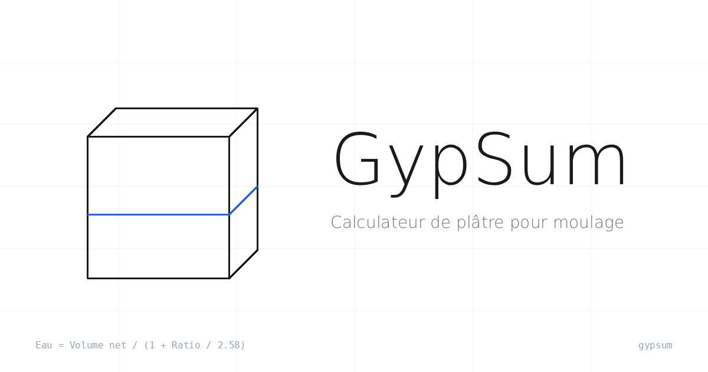

# GypSum

[](https://cedric-ruiu.github.io/gyp-sum/en/) [](https://vuejs.org/) [](https://vitejs.dev/) [](https://www.typescriptlang.org/) [](https://tailwindcss.com/) [](https://threejs.org/) [](LICENSE) [](https://cedric-ruiu.github.io/gyp-sum/)

**Use it online:** [Plaster calculator for mold making (English)](https://cedric-ruiu.github.io/gyp-sum/en/) · [Calculateur de plâtre pour moulage (français)](https://cedric-ruiu.github.io/gyp-sum/) · [Calculadora de yeso para moldes (español)](https://cedric-ruiu.github.io/gyp-sum/es/)

**Guide:** [How to make a plaster mold for pottery](https://cedric-ruiu.github.io/gyp-sum/en/how-to-make-a-plaster-mold/) · [Faire un moule en plâtre pour la céramique](https://cedric-ruiu.github.io/gyp-sum/moule-en-platre/)

---

## What is it?

**GypSum** is a precision plaster calculator for mold making. It computes the exact water and plaster quantities needed to fill a mold, based on the density of powdered plaster (2.58 kg/L) and the net volume between the mold and the object being cast.

No more guessing, no more wasted material. Just enter your mold dimensions, describe the object inside, set your mixing ratio and safety margin — GypSum does the math.

---

## Features

- **Mold configurator** — supports box and cylinder shapes, with per-dimension input
- **Object configurator** — supports box, cylinder, cone frustum, sphere, half-sphere and spherical cap shapes, or direct volume entry
- **Mix parameters** — configurable plaster-to-water ratio and waste margin
- **Live 3D scene** — interactive wireframe preview of the mold and object, with orbit controls and auto-rotation
- **Precise formulas** — water and plaster amounts derived from plaster density, not rule-of-thumb ratios
- **State persistence** — your inputs are saved in `localStorage` and restored on next visit
- **No installation** — runs entirely in the browser, no account or backend required
- **Three languages** — French, English (with US units) and Spanish, plus a step-by-step mold-making guide in French and English

---

## How it works

GypSum uses the following formula, fixed and not user-configurable:

```
Net volume  = Mold volume − Object volume
Water       = Net volume / (1 + Ratio / 2.58)
Plaster     = Ratio × Water
```

The constant **2.58 kg/L** is the density of powdered plaster (calcium sulfate hemihydrate, CaSO₄·½H₂O). It varies slightly between plasters; the effect on the amounts stays below the default 10% safety margin.

Dimensions are entered in centimeters and results are displayed in liters and kilograms. The English page can also show inches, US cups / fluid ounces and pounds / ounces, and accepts the ratio as a consistency (parts water per 100 parts plaster); calculations always run in metric.

---

## Tech stack

| Layer | Technology |
|---|---|
| Framework | Vue 3 — Composition API + `<script setup>` |
| Build | Vite 8 |
| Language | TypeScript 6 |
| Styling | Tailwind CSS v4 (`@tailwindcss/vite`) |
| 3D | Three.js + OrbitControls |
| i18n | vue-i18n 11 (French, English, Spanish) |
| Linting | Biome 2.4 |
| Hosting | GitHub Pages (static SPA) |

---

## Local development

```bash
# Install dependencies
yarn install

# Start dev server
yarn dev

# Type-check + production build
yarn build

# Lint
yarn lint

# Auto-format (lint + organize imports)
yarn format
```

---

## Contributing

Issues and pull requests are welcome. If you spot a calculation error or want to add a new shape, [open an issue](https://github.com/Cedric-ruiu/gyp-sum/issues) first to discuss the approach.

---

## License

[MIT](LICENSE) — Cédric Ruiu
